# 🍔 StreetBite

**StreetBite** is a bilingual food discovery and ordering application built with Flutter. It allows users to explore meals, manage favorites and cart items, place orders, and manage their profiles through a simple and user-friendly interface.

## ✨ Features

- 🔐 **Authentication:** Sign up and log in using Firebase Authentication.
- 🍽️ **Meal Discovery:** Browse meals using TheMealDB API.
- ❤️ **Favorites:** Save and manage favorite meals.
- 🛒 **Shopping Cart:** Add meals, update quantities, and manage cart items.
- 📦 **Orders:** Place orders and view order history.
- 👤 **Profile Management:** View and update profile information and photo.
- 📍 **Nearby Vendors:** Explore vendor information.
- 🌐 **Localization:** Supports English and Arabic.
- 🎨 **Themes:** Light and dark modes.
- 🔒 **Biometric Authentication:** Protect access to the profile with biometric verification.

## 🛠️ Technologies

- Flutter & Dart
- Firebase Authentication
- Cloud Firestore
- Dio & REST API
- Cubit / flutter_bloc
- GetIt for Dependency Injection
- Easy Localization
- Clean Architecture

## 📸 Screenshots

### Authentication

<p align="center">
  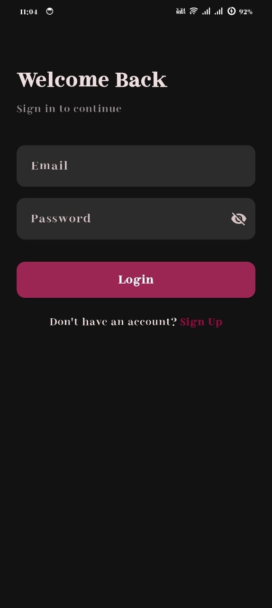
  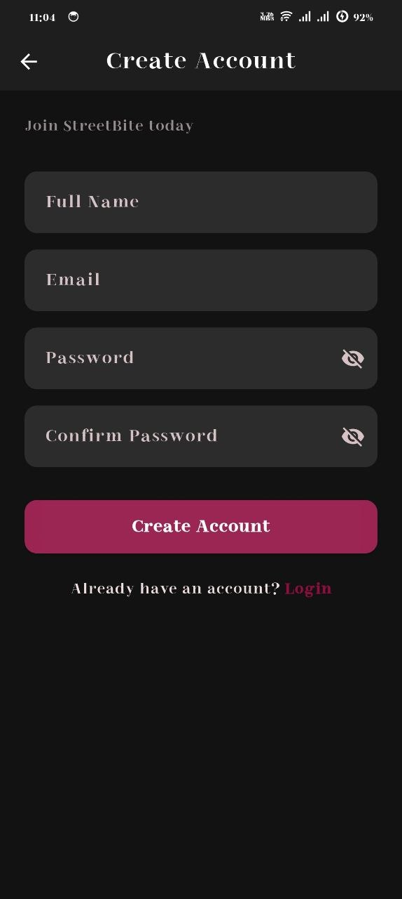
</p>

### Home & Vendors

<p align="center">
  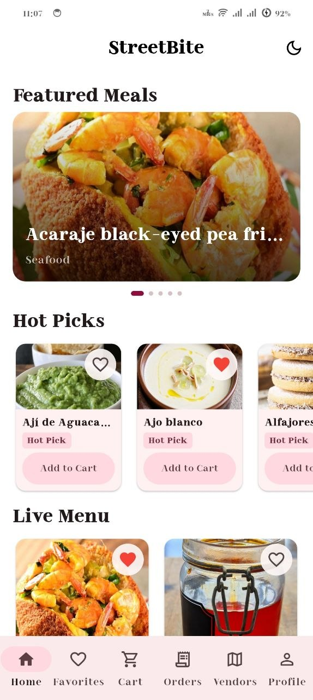
  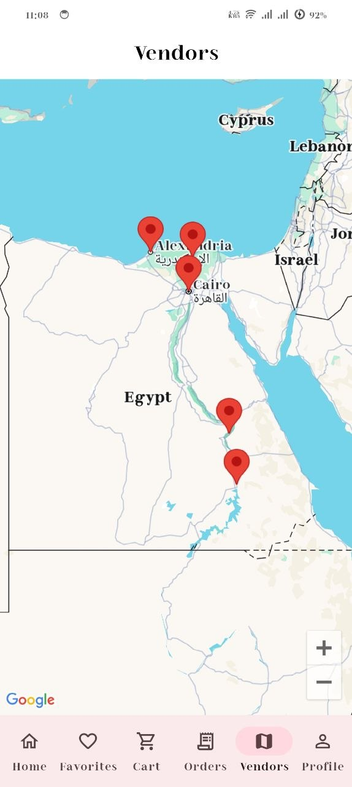
</p>

### Favorites & Cart

<p align="center">
  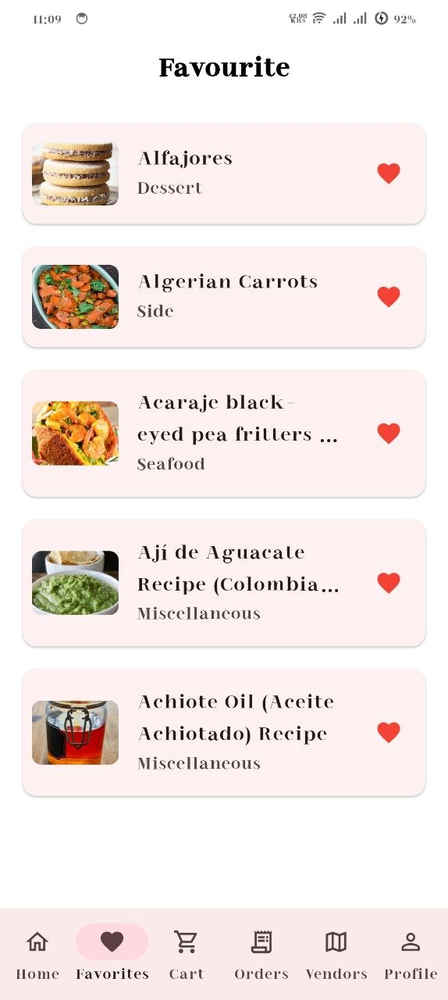
  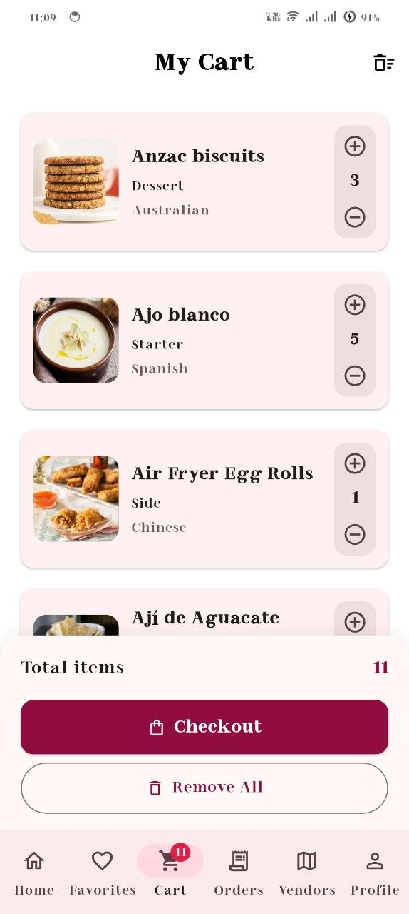
</p>

### Orders & Profile

<p align="center">
  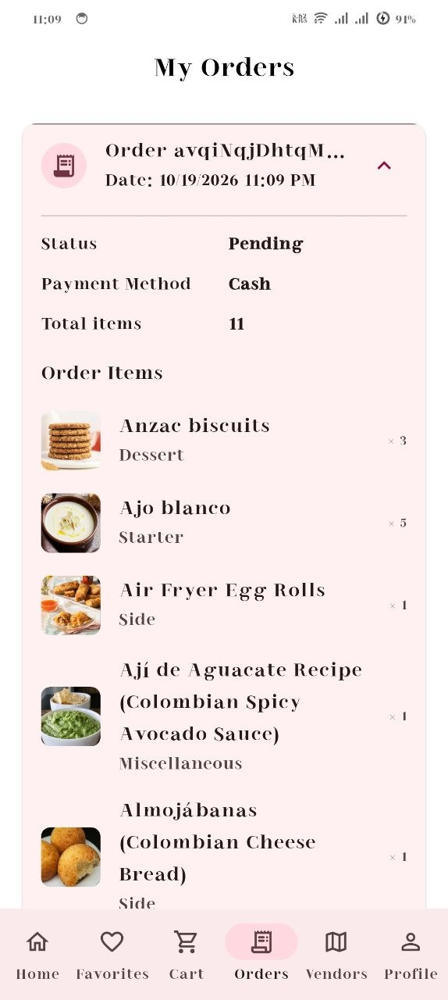
  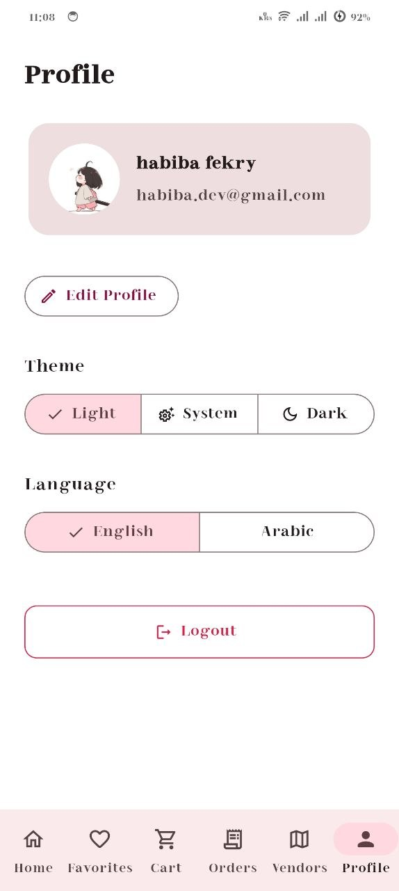
</p>

### Arabic Interface

<p align="center">
  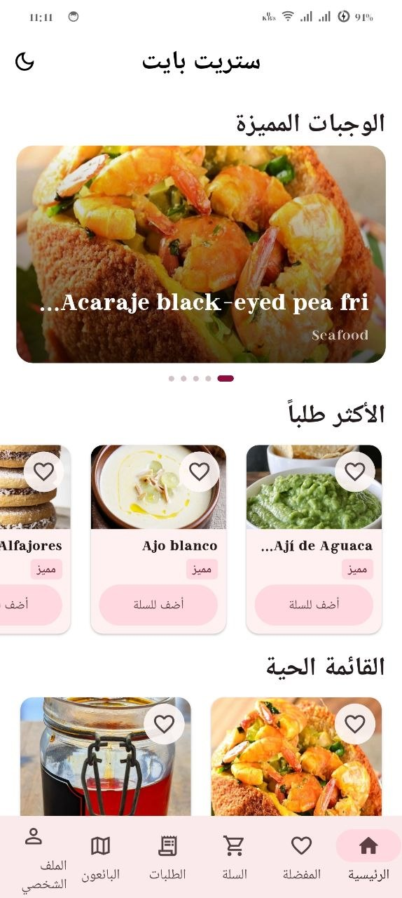
  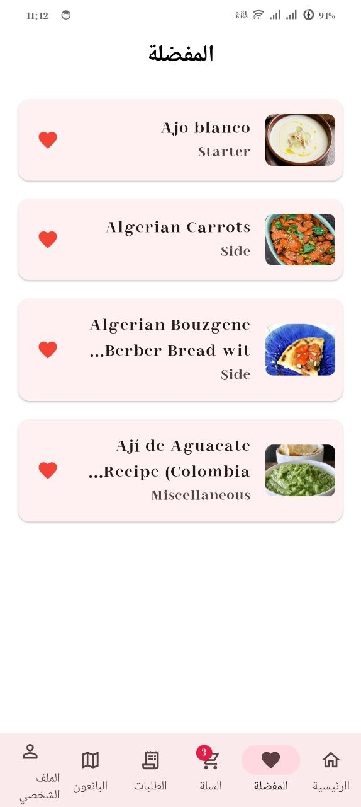
  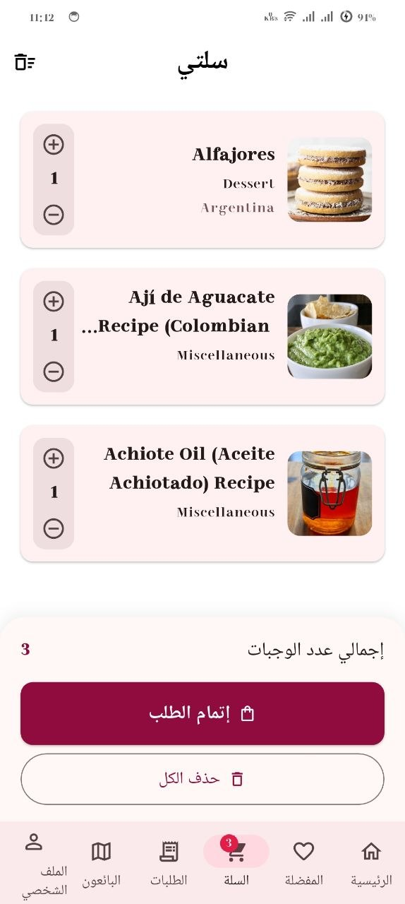
  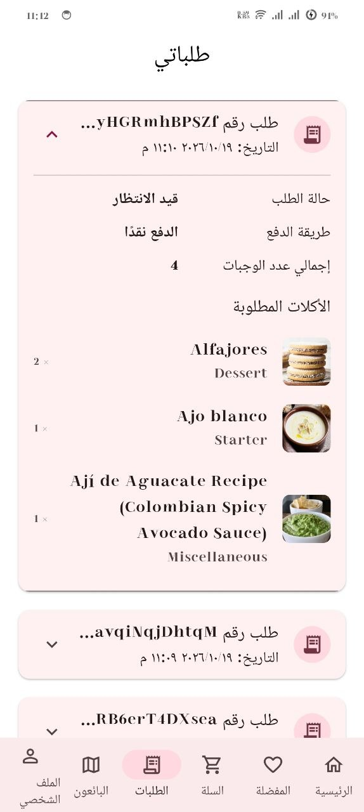
  
</p>

## 🏗️ Architecture

The project follows **Clean Architecture**, separating responsibilities into:

- **Data:** Data sources, models, and repository implementations.
- **Domain:** Entities, repository contracts, and use cases.
- **Presentation:** Screens, widgets, Cubits, and states.

Shared services and dependency injection are organized under the `core` directory.

## 🚀 Getting Started

### Prerequisites

- Flutter SDK
- Dart SDK
- A Firebase project
- An IDE such as Android Studio or VS Code

### Installation

1. Clone the repository:

   ```bash
   git clone https://github.com/habibafekry3/Street-Bite-.git
   ```

2. Open the project directory:

   ```bash
   cd Street-Bite-
   ```

3. Install dependencies:

   ```bash
   flutter pub get
   ```

4. Configure Firebase for your platform using the [official FlutterFire documentation](https://firebase.google.com/docs/flutter/setup).

5. Run the application:

   ```bash
   flutter run
   ```

## 🔐 Firebase Configuration

Configure your own Firebase project before running the application. Do not commit private credentials, service-account keys, or sensitive configuration files to a public repository.

## 🎯 Project Goal

StreetBite was developed as a Flutter graduation project to practice mobile application development, state management, API integration, Firebase services, localization, and Clean Architecture.

## 👩‍💻 Developer

**Habiba Fekry**

GitHub: [@habibafekry3](https://github.com/habibafekry3)
